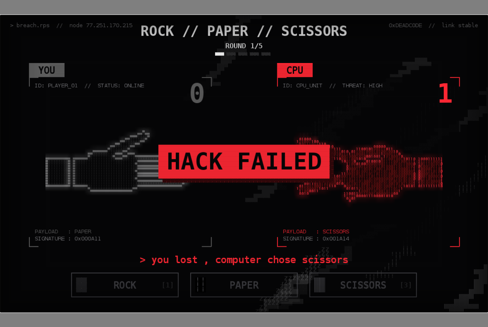

# ROCK // PAPER // SCISSORS — hacker HUD edition

Rock Paper Scissors against a rogue AI that **learns your habits**. Read its mind through meme riddles, spend hacker abilities to outplay it, and decrypt its secret log one win at a time. It has a glitchy "hacker terminal" look, animated hands, music and sound effects. Written in Python with pygame. It runs on the desktop and in a web browser.

### ▶ [Play it in your browser](https://raftan10.github.io/rock-paper-scissors-visualized-cyber-version-/)



## Features

**Modes**

- **Quick Match.** Best of 5 against the AI. A tied match goes to **sudden death**: slow motion, red screen, first round won takes it.
- **Endless.** 3 lives. The AI gets harder every 5 wins. Score points, chain streaks for bonuses, and get on the top 10.
- **2 Player.** Two people on one keyboard. Both pick in secret, then the hands reveal.

**Playing against the AI**

- **Three difficulty levels.** SCRIPT KIDDIE is mostly random. FIREWALL learns what you play after each move. BLACK ICE remembers your last two moves and your favourite, and switches to whichever trick works.
- **Meme riddles.** Each round you intercept one of the CPU's thoughts, such as *"Money printer go BRRRR."* (paper) or *"Never gonna give you up. Never gonna fold."* (not paper). After the round the joke is explained. Harder levels give vaguer riddles.
- **Hacker abilities.** Spend tokens on **BRAIN SCAN** to see fuzzy bars of what the CPU is leaning towards, **OVERCLOCK** to make a win count double, or **FIREWALL** to turn a loss into a tie. Earn more tokens with win streaks. A **mission briefing** before each match explains the riddles and abilities, and the ability bar pulses in round 1 so nobody misses it.
- **A story.** Every match you win decrypts a fragment of the AI's private log. Read them in the **Archive**. The last one is the ending.

**Everything else**

- **Rankings.** A local top 10 with arcade-style initials, plus a hacker rank from SCRIPT KIDDIE up to ROOT.
- **Streaks, combo breakers and taunts.** The CPU types a reply after every round.
- **End-of-game stats.** A chart of your moves, and how often the AI read you correctly.
- **Saved progress.** Records, top 10 and story progress are saved in your browser, or in `records.json` on a PC.
- **Easy to tweak.** Rounds, lives, tokens, colours, names, glitch strength, volume and taunts are in the **GAME SETTINGS** block at the top of [`rps_visual.py`](rps_visual.py). Riddles are in [`riddles.py`](riddles.py) and the story in [`story.py`](story.py).

## How to play

| Key | Action |
|---|---|
| `↑` / `↓` + `Enter`, a number, or click | choose in the menus |
| `1` / `2` / `3`, or click a button | rock / paper / scissors |
| `Q` / `W` / `E`, or click | BRAIN SCAN / OVERCLOCK / FIREWALL |
| `A` `S` `D` and `J` `K` `L` | 2 Player: player 1 and player 2 |
| `Space` or click | next round |
| any key or click | play again on the final screen |
| `B` or `Backspace` | back to the menu |
| `M` | mute / unmute |
| `F` | fullscreen (browser) |

The first load in a browser can take a while, because it downloads a small Python runtime. After that it's cached. Click the page once to start, which lets the browser play sound.

## How it works

The project is split into a **brain** and a **face**:

| File | Role |
|---|---|
| [`try1.py`](try1.py) | **The brain:** the game rules and the AI. A dictionary maps keys to moves (`{'1': 'rock', ...}`), `get_winner()` decides each round, and `smart_computer_choice()` with `remember()` is the learning AI. Run on its own, it's a text version of the game in the terminal. |
| [`rps_visual.py`](rps_visual.py) | **The face:** the pygame window, the screens, the hand animations, the effects and the sound. It **imports the rules from `try1.py`** instead of copying them, so changing a rule there changes the visual game too. |
| [`opponents.py`](opponents.py) | The three difficulty levels. NORMAL is exactly the AI from `try1.py`. |
| [`riddles.py`](riddles.py) | The meme riddles, and how often each difficulty gives them. |
| [`story.py`](story.py) | The title screen text and the AI's secret log. |
| [`main.py`](main.py) | Starts the web version. |
| [`build_web.py`](build_web.py) | Builds the browser version with [pygbag](https://github.com/pygame-web/pygbag). |

`try1.py` puts its console game under `if __name__ == "__main__":`, so importing it doesn't start the console game.

The visual game runs a loop about 60 times a second, with three steps:

1. **Input:** read key presses and clicks.
2. **Update:** advance the animation, decide the winner, update the score and play sounds.
3. **Draw:** redraw the whole screen.

The game moves between screens: `title → menu → match → final`, plus rankings, the archive and initials entry. Inside a match, each round moves through four states: `choose → shake → reveal → result`. When the match is over there's a `final` screen.

### How the AI learns

The AI keeps a table of **what you played right after each move**:

```
                 next move →  rock  paper  scissors
after rock                      1      4       0
after paper                     2      0       1
```

If your last move was rock, the table says you usually follow it with **paper**, so the AI plays **scissors**. The AI picks its move at the **start** of each round, using only past rounds, and **then** learns your move, so it never sees your current move before choosing. Because the move already exists, the riddles and BRAIN SCAN can hint at it honestly. Its memory carries over from one game to the next, so it gets better the longer you play.

The hands aren't images. Each one is drawn as a shape, sampled into a 60 × 40 grid, and every cell is filled with a texture or a `0`/`1` digit. That's what gives them the retro look.

### Making it work in a browser

- **pygbag** packages the game, and the browser runs it with Python compiled to WebAssembly.
- The game loop calls `await asyncio.sleep(0)` every frame, so the browser stays responsive.
- The sounds are `.ogg` files and the font file ships with the game, because browsers can't play every sound format and have no system fonts.
- In the browser, Python starts with the same random seed on every load, so `main.py` re-seeds it from the clock. Otherwise the computer would make the same moves every game.
- **GitHub Actions** ([workflow](.github/workflows/deploy-web.yml)) rebuilds the web version and publishes it to GitHub Pages on every push.

## Run it on your computer

```bash
python -m venv .venv
.venv\Scripts\activate          # Windows  (macOS/Linux: source .venv/bin/activate)
pip install pygame-ce
python rps_visual.py            # visual version
python try1.py                  # text version in the terminal
```

To test the web version locally:

```bash
pip install pygbag
python build_web.py --serve     # then open http://localhost:8000
```

## Credits

- Font: [DejaVu Sans Mono](https://dejavu-fonts.github.io/). Its license is in [`fonts/DejaVu-LICENSE.txt`](fonts/DejaVu-LICENSE.txt).
- The sound effects and music were generated for this project.
